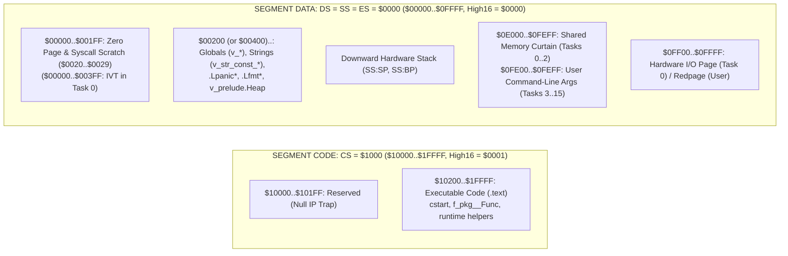

# Intel 8086 Backend & Assembler Design Plan (`minigolf -m=8086`, `asm8086`)

This document specifies the design and implementation plan for targeting the **Intel 8086 / 8088** platform (`gep0` / **Hatvan OS/0**, architecture code `'0'`) in the MiniGolf compiler and toolchain, following the [Hatvan OS/0 & Hatvan VM/0 Specification](file:///home/strick/github.com/strickyak/hatvan-os/doc/spec-hatvan-8086.md).

---

## 1. Architecture Overview & Toolchain Targets

| Component | Path in `minigolf` | Role |
| :--- | :--- | :--- |
| **Compiler Flag** | [`main.go`](file:///home/strick/github.com/strickyak/minigolf/main.go) | `-m=8086`, `-m=i8086`, or `-m=0` (`WordSize: 2`, `cDefines["unix"] = "0"`) |
| **Backend Package** | `i8086/backend.go` | SSA IR $\rightarrow$ Intel 8086 assembly (`SEGMENT CODE` + `SEGMENT DATA`) |
| **Bare-Metal Runtime** | `i8086/cstart.asm` | Standalone startup, `_putchar`/`_getchar`/`_exit` (`$FF00`/`$FF01`/`$FF05`), `_printf`, `_panic`, math/setjmp helpers |
| **8086 Assembler** | `cmd/asm8086/main.go` | Multi-pass Intel 8086 assembler with `SEGMENT CODE`/`DATA`, `Jcc` branch relaxation, and Extended DECB (`'x'`, `'0'`) output |
| **Assembler Tests** | `cmd/asm8086/asm8086_test.go` | Unit tests for instruction encodings, ModR/M modes, `Jcc` relaxation, and multi-segment DECB emission |
| **Test Runner** | `run0.sh` | Compiles `.golf`/`.c`/`.asm` with `minigolf -m=8086`, assembles with `asm8086`, and runs on `gep0` |
| **System Tests** | `i8086_system_test.go` / [`system_test.go`](file:///home/strick/github.com/strickyak/minigolf/system_test.go) | End-to-end verification across `tests/*.golf` and `c-tests/*.c` |

---

## 2. Memory Model: Small (Split Instruction & Data, 128 KB per Task)

Hatvan OS/0 and MiniGolf use the **Small (Split I&D)** memory model, giving every process **128 KB (`$00000..$1FFFF`)** of physical task space divided into two 64 KB segments:



### 2.1 Key Invariants of the Split I&D Model

1. **16-Bit Native `word` and Data Pointers**:
   * `sizeof[word]() == 2`, `sizeof[int]() == 2`, `sizeof[*T]() == 2`, `sizeof[string]() == 6`, `sizeof[slice[T]]() == 6`.
   * All function calls and returns are 16-bit near `CALL` (`E8 disp16` or `FF /2`) and `RET` (`C3`) within `CS = $1000`.
2. **Unified Data/Stack/Extra Segment (`DS == SS == ES == $0000`)**:
   * On the 8086, `[BP+disp]` defaults to segment `SS`, `[BX]`/`[SI]`/`[DI]`/`[disp16]` default to `DS`, and string instructions (`REP MOVSB`, `REP STOSB`) use `ES:[DI]` as destination and `DS:[SI]` as source.
   * Because `DS == SS == ES == $0000` is maintained at all times (along with `DF = 0` via `CLD`), a pointer to a stack local (`LEA AX, [BP-disp]`), a global variable (`MOV AX, v_glob`), a heap block, or a string literal can be dereferenced through `[BX]`, `[SI]`, or `[DI]` without any segment override prefixes.
3. **Strict Section Separation (`SEGMENT CODE` vs. `SEGMENT DATA`)**:
   * All executable instructions (`cstart`, `_main`, `f_*`, runtime helpers) **must** be emitted in `SEGMENT CODE`.
   * All global variables (`v_*`), string constants (`v_str_const_*`, `.Lstr*`, `.Lfmt*`), panic strings (`.Lpanic*`), and runtime state words (`v_prelude._jmp_chain_`, `v_prelude._panic_`) **must** be emitted in `SEGMENT DATA`.
   * Read-only data must **never** be placed in `SEGMENT CODE`, because pointer dereferences read from `DS` (`$0000`), not `CS` (`$1000`).
4. **Configurable Data Segment Origin (`-global_var_offset`)**:
   * By default, `SEGMENT DATA` begins at `ORG $0200` (`512`), keeping `$0000..$01FF` free for `nil` pointer detection and the user syscall scratch area (`$0020..$0029`).
   * When `-global_var_offset <N>` is passed on the command line (e.g., `-global_var_offset 1024` (`$0400`) for Task 0 kernel to preserve the 8086 Interrupt Vector Table at `$0000..$03FF`, or `-global_var_offset 512` for drivers/userland), `i8086` emits `ORG <N>` at the start of `SEGMENT DATA`.

---

## 3. Register Conventions, Stack Frame Layout, and Calling Convention (ABI)

### 3.1 Register Roles

| Register | 8-Bit Halves | Role in MiniGolf `i8086` Backend | Preservation |
| :--- | :---: | :--- | :--- |
| **`AX`** | `AH:AL` | Primary 16-bit (`AX`) and 8-bit (`AL`) accumulator; function return value | Caller-saved (scratch) |
| **`DX`** | `DH:DL` | Secondary 16-bit (`DX`) / 8-bit (`DL`) operand; high word for `MUL`/`DIV`/`IDIV`/`CWD` | Caller-saved (scratch) |
| **`BX`** | `BH:BL` | Pointer dereference / base address register (`[BX]`, `[BX+disp]`) and scratch | Caller-saved (scratch) |
| **`CX`** | `CH:CL` | Shift count (`CL`), `REP MOVSB`/`STOSB` byte count (`CX`), hidden struct-return pointer on entry | Caller-saved (scratch) |
| **`SI`** | — | Source address register (`DS:[SI]`) for `REP MOVSB` and indexed loads | Caller-saved (scratch) |
| **`DI`** | — | Destination address register (`ES:[DI]`) for `REP MOVSB` / `REP STOSB` | Caller-saved (scratch) |
| **`BP`** | — | Hardware Frame Pointer (`SS:BP`) | **Callee-saved** |
| **`SP`** | — | Hardware Stack Pointer (`SS:SP`, grows downward) | Callee-restored (`MOV SP, BP`) |

### 3.2 Hardware Stack Frame Layout (`SS:BP`)

Unlike the Z80 (where `(ix+d)` is restricted to a signed 8-bit displacement `-128..+127`, requiring `frameBias` gymnastics for large frames) or the 6502 (which requires a software stack in zero page), the 8086 supports both 8-bit (`Mod=01`, 3 bytes) and full 16-bit (`Mod=10`, 4 bytes) signed displacements off `BP` (`[BP+disp8]` and `[BP+disp16]`), as well as single-instruction address calculation via `LEA reg, [BP+disp]`.

```
High Memory ($0FDFF / $0DFFF)
+-----------------------------------+
| Caller Argument N-1               | [BP + 4 + ...]
| ...                               |
| Caller Argument 0                 | [BP + 4]
+-----------------------------------+
| Return IP (16-bit near offset)    | [BP + 2]
+-----------------------------------+
| Saved Caller BP                   | [BP + 0]  <-- BP points here
+-----------------------------------+
| Hidden RetPtr (if retSize > 2)    | [BP - 2]  (saved from CX in prologue)
| Local / SSA Slot 1                | [BP - off_1]
| Local / SSA Slot 2                | [BP - off_2]
| ...                               |
| SetJmp Buffer (8 bytes, if used)  | [BP - jmpSlot]
| ...                               |
| Local / SSA Slot K                | [BP - stackSize] <-- SP points here
+-----------------------------------+
Low Memory
```

### 3.3 Function Prologue & Epilogue

* **Prologue**:
  ```x86asm
  f_pkg__Func:
      PUSH BP
      MOV  BP, SP
      SUB  SP, <stackSize>    ; omitted when stackSize == 0
      MOV  [BP-2], CX         ; only emitted when retSize > 2 (composite return)
  ```
* **Epilogue**:
  ```x86asm
      MOV  SP, BP             ; omitted when stackSize == 0
      POP  BP
      RET
  ```

### 3.4 Calling Convention (`cdecl`-style Right-to-Left)

1. **Arguments**:
   * Pushed onto the hardware stack right-to-left (`idx = len(Args)-1` down to `0`).
   * Every stack argument slot is aligned to an even 2-byte boundary (`pushSize = alignVal(sz, 2)`):
     * **1-byte (`byte`, `bool`)**: Loaded into `AL`, zero-extended (`MOV AH, 0`), and pushed with `PUSH AX`.
     * **2-byte (`word`, `int`, `*T`, func ptr)**: Pushed directly (`PUSH AX`, `PUSH WORD PTR [BP-d]`, or `PUSH WORD PTR [v_glob]`).
     * **Composite (`> 2` bytes, e.g. `string`, `slice`, `struct`, `array`)**:
       ```x86asm
       SUB  SP, <pushSize>
       LEA  SI, [BP-srcOff]   ; (or MOV SI, v_glob)
       MOV  DI, SP
       MOV  CX, <sz>
       REP  MOVSB
       ```
2. **Return Values**:
   * **1-byte (`byte`, `bool`)**: Returned in `AL` with `AH = 0` (`AX` zero-extended).
   * **2-byte (`word`, `int`, `*T`)**: Returned in `AX`.
   * **Composite (`> 2` bytes)**:
     * Before `CALL`, caller loads the destination slot's address into `CX` (`LEA CX, [BP-dstOff]`).
     * Callee saves `CX` at `[BP-2]` on entry and copies `retSize` bytes from the return value into `DI = [BP-2]` using `REP MOVSB` before returning.
3. **Caller Stack Cleanup**:
   * For `totalArgBytes == 2`: `POP CX` (1 byte, preserves `AX`).
   * For `totalArgBytes == 4`: `POP CX; POP CX` (2 bytes, preserves `AX`).
   * For `totalArgBytes > 4`: `ADD SP, <totalArgBytes>` (3 or 4 bytes, preserves `AX`).

---

## 4. SSA IR Instruction Lowering (`i8086/backend.go`)

### 4.1 Slot Allocation (`allocateSlots`)

`allocateSlots(f *ir.Function)` mirrors [`z80/backend.go`](file:///home/strick/github.com/strickyak/minigolf/z80/backend.go#L159-L280) with two simplifications enabled by the 8086 ISA:
1. **No `frameBias` needed**: `[BP-off]` and `[BP+off]` directly encode any 8-bit or 16-bit signed displacement.
2. **Constants & Addresses**: `ConstByte`, `ConstWord`, `Sizeof`, `AddressOfGlobal`, and `AddressOfFunc` do not require stack slots unless their address is taken via `AddressOfLocal`; they are materialized inline as immediate operands.
3. **Fused Compare-and-Branch**: Single-use `Compare` instructions that feed a `Branch` terminator (including `neq(cmp, 0)` patterns) are marked in `b.fusedCompares` and skip slot allocation and boolean materialization, emitting `CMP` + `Jcc` directly.

### 4.2 Value Loading & Storing Primitives

* **`loadVal(val ir.Value, reg string)`**:
  * Supports `reg` $\in$ `{"al", "dl", "cl", "ax", "dx", "bx", "cx", "si", "di"}`.
  * For `ConstByte` / `ConstWord` / `Sizeof`:
    * `val == 0` into 16-bit reg (when flags are not live): `XOR AX, AX` (2 bytes) or `MOV AX, 0` (3 bytes).
    * Non-zero constant: `MOV AX, <imm16>` / `MOV AL, <imm8>`.
  * For `AddressOfGlobal` / `AddressOfFunc`: `MOV <reg16>, v_<name>` / `MOV <reg16>, <funcName>`.
  * For `AddressOfLocal`: `emitLoadAddr(reg16, v.Local)`.
  * For `Parameter`:
    * 1-byte into 8-bit reg: `MOV AL, [BP+off]`
    * 1-byte into 16-bit reg: `MOV AL, [BP+off]; MOV AH, 0`
    * 2-byte into 16-bit reg: `MOV AX, [BP+off]`
  * For `Global`:
    * 1-byte into 8-bit reg: `MOV AL, [v_<name>]`
    * 1-byte into 16-bit reg: `MOV AL, [v_<name>]; MOV AH, 0`
    * 2-byte into 16-bit reg: `MOV AX, [v_<name>]`
  * For `ir.Instruction` (local slot at `[BP-off]`):
    * 1-byte into 8-bit reg: `MOV AL, [BP-off]`
    * 1-byte into 16-bit reg: `MOV AL, [BP-off]; MOV AH, 0`
    * 2-byte into 16-bit reg: `MOV AX, [BP-off]`
* **`emitLoadAddr(reg string, val ir.Value)`**:
  * `Parameter`: `LEA <reg>, [BP+off]`
  * `Instruction`: `LEA <reg>, [BP-off]`
  * `Global` / `AddressOfGlobal`: `MOV <reg>, v_<name>`
  * `AddressOfFunc`: `MOV <reg>, <funcName>`
* **`storeResult(id int)`**:
  * 1-byte result in `AL`: `MOV [BP-off], AL`
  * 2-byte result in `AX`: `MOV [BP-off], AX`

### 4.3 Arithmetic, Bitwise, and Shift Operations (`emitBinaryOp` & `emitUnaryOp`)

| IR Operation | 8-Bit (`byte`) Lowering (`AL`) | 16-Bit (`word` / `int` / `*T`) Lowering (`AX`) |
| :--- | :--- | :--- |
| **`add`** | `ADD AL, <rhs>` (or `INC AL` for `1`) | `ADD AX, <rhs>` (or `INC AX` for `1`, `ADD AX, imm`) |
| **`sub`** | `SUB AL, <rhs>` (or `DEC AL` for `1`) | `SUB AX, <rhs>` (or `DEC AX` for `1`, `SUB AX, imm`) |
| **`and` / `bitand`** | `AND AL, <rhs>` | `AND AX, <rhs>` |
| **`or` / `bitor`** | `OR AL, <rhs>` | `OR AX, <rhs>` |
| **`xor` / `bitxor`** | `XOR AL, <rhs>` | `XOR AX, <rhs>` |
| **`andnot`** | `loadVal(R, "dl"); NOT DL; AND AL, DL` | `loadVal(R, "dx"); NOT DX; AND AX, DX` |
| **`mul`** | Widened to 16-bit: `MUL DX` $\rightarrow$ `AL` | `loadVal(L, "ax"); loadVal(R, "dx"); MUL DX` |
| **`div` (unsigned)** | Widened to 16-bit `word` | `loadVal(L, "ax"); loadVal(R, "bx"); CALL __udiv16` |
| **`div` (signed `int`)** | — | `loadVal(L, "ax"); loadVal(R, "bx"); CALL __div16` |
| **`mod` (unsigned)** | Widened to 16-bit `word` | `loadVal(L, "ax"); loadVal(R, "bx"); CALL __umod16` |
| **`mod` (signed `int`)** | — | `loadVal(L, "ax"); loadVal(R, "bx"); CALL __mod16` |
| **`shl`** | `MOV CL, <rhs>; SHL AL, CL` (or `SHL AL, 1`) | Const `1..3`: repeated `SHL AX, 1`; else `MOV CL, <rhs>; SHL AX, CL` |
| **`shr` (unsigned)** | `MOV CL, <rhs>; SHR AL, CL` (or `SHR AL, 1`) | Const `1..3`: repeated `SHR AX, 1`; else `MOV CL, <rhs>; SHR AX, CL` |
| **`shr` (signed `int`)** | — | Const `1..3`: repeated `SAR AX, 1`; else `MOV CL, <rhs>; SAR AX, CL` |
| **`neg` (unary)** | `NEG AL` | `NEG AX` |
| **`not` / `bitnot`** | `NOT AL` (bitwise) or `XOR AL, 1` (bool) | `NOT AX` |

> [!NOTE]
> **Why call tiny `__udiv16` / `__div16` / `__umod16` / `__mod16` wrappers around hardware `DIV`/`IDIV`?**
> On the 8086, dividing by zero (or signed `-32768 / -1` overflow) triggers hardware `INT 0`. Calling a 6-instruction helper checks `TEST BX, BX; JZ __div_zero` (which calls `_panic("division by zero")`, matching all other MiniGolf targets) and executes `XOR DX, DX; DIV BX` (or `CWD; IDIV BX`).

### 4.4 Comparisons & Fused Conditional Branches (`emitCompare` & `emitFusedCompareAndBranch`)

The 8086 `CMP` instruction sets `ZF`, `CF`, `SF`, and `OF`, enabling single-instruction conditional jumps for both unsigned (`word`, `byte`, `*T`) and signed (`int`) comparisons:

| IR Compare Op | Unsigned `Jcc` (`word`, `byte`, `*T`) | Signed `Jcc` (`int`) | Inverted `J!cc` (for Branch Relaxation) |
| :---: | :---: | :---: | :---: |
| **`eq`** | `JE` (`74`) | `JE` (`74`) | `JNE` (`75`) |
| **`neq`** | `JNE` (`75`) | `JNE` (`75`) | `JE` (`74`) |
| **`lt`** | `JB` (`72`) | `JL` (`7C`) | `JAE` (`73`) / `JGE` (`7D`) |
| **`lte`** | `JBE` (`76`) | `JLE` (`7E`) | `JA` (`77`) / `JG` (`7F`) |
| **`gt`** | `JA` (`77`) | `JG` (`7F`) | `JBE` (`76`) / `JLE` (`7E`) |
| **`gte`** | `JAE` (`73`) | `JGE` (`7D`) | `JB` (`72`) / `JL` (`7C`) |

* **Standalone `Compare` (materializing `0` or `1` in `AL`)**:
  ```x86asm
      ; Compare Left and Right (8-bit CMP AL, ... or 16-bit CMP AX, ...)
      MOV  AL, 1
      J<cc> .LL_done
      MOV  AL, 0          ; (do not use XOR AL, AL before Jcc, after Jcc XOR AL, AL is fine)
  .LL_done:
      MOV  [BP-off], AL
  ```
* **Fused Compare-and-Branch**:
  Emits `CMP` followed directly by `J<cc> <trueTarget>` and fallthrough / `JMP <falseTarget>`.

### 4.5 Memory, Pointer, Struct, and Array Operations

* **`Load` / `Store` (Globals)**:
  * `sz == 1`: `MOV AL, [v_glob]` / `MOV [v_glob], AL`
  * `sz == 2`: `MOV AX, [v_glob]` / `MOV [v_glob], AX`
  * `sz > 2`: `MOV SI, v_glob; LEA DI, [BP-off]; MOV CX, <sz>; REP MOVSB`
* **`LoadPtr` / `StorePtr`**:
  * Direct global address optimization (`getDirectGlobalAddr`): folds `*(&v_glob + constOffset)` into direct `[v_glob + offset]` memory operand without loading `BX`.
  * Indirect pointer: `loadVal(i.Ptr, "bx")`:
    * `sz == 1`: `MOV AL, [BX]` / `MOV [BX], AL`
    * `sz == 2`: `MOV AX, [BX]` / `MOV [BX], AX`
    * `sz > 2`: `SI`/`DI` + `MOV CX, <sz>; REP MOVSB`
* **`AddressOfField` / `AddressOfElement`**:
  * Constant offset on global: `MOV AX, v_glob + <byteOffset>`
  * Constant offset on pointer: `loadVal(ptr, "ax"); ADD AX, <byteOffset>`
  * Dynamic array index:
    * `eltSize == 1`: `loadVal(arr, "ax"); loadVal(idx, "dx"); ADD AX, DX`
    * `eltSize == 2`: `loadVal(idx, "ax"); SHL AX, 1; loadVal(arr, "dx"); ADD AX, DX`
    * `eltSize == 4`: `loadVal(idx, "ax"); SHL AX, 1; SHL AX, 1; loadVal(arr, "dx"); ADD AX, DX`
    * `eltSize == 6` (`string` / `slice`): `loadVal(idx, "ax"); SHL AX, 1; MOV DX, AX; SHL AX, 1; ADD AX, DX; loadVal(arr, "dx"); ADD AX, DX`
    * General `eltSize`: `loadVal(idx, "ax"); MOV DX, <eltSize>; MUL DX; loadVal(arr, "dx"); ADD AX, DX`
* **`ZeroInit`**:
  * `sz == 1`: `MOV BYTE PTR [BP-off], 0`
  * `sz == 2`: `MOV WORD PTR [BP-off], 0`
  * `sz > 2`: `LEA DI, [BP-off]; XOR AL, AL; MOV CX, <sz>; REP STOSB`

### 4.6 `SetJmp`, `LongJmp`, and `panic` / `recover`

* **`SetJmp` (`8`-byte `jmpbuf` at `[BP-jmpSlot]`)**:
  ```x86asm
      LEA  BX, [BP-jmpSlot]
      MOV  AX, [v_prelude._jmp_chain_]
      MOV  [BX], AX                       ; +0: prev _jmp_chain_
      MOV  [v_prelude._jmp_chain_], BX
      MOV  WORD PTR [BX+2], .LL_resume    ; +2: resume IP
      MOV  [BX+4], SP                     ; +4: saved SP
      MOV  [BX+6], BP                     ; +6: saved BP
      XOR  AL, AL
      JMP  .LL_done
  .LL_resume:
      MOV  AL, 1
  .LL_done:
      MOV  [BP-idSlot], AL
  ```
* **`__longjmp_ax` (in `SEGMENT CODE`)**:
  ```x86asm
  __longjmp_ax:
      MOV  BX, AX
      MOV  SP, [BX+4]
      MOV  BP, [BX+6]
      JMP  WORD PTR [BX+2]
  ```
* **`_unlink_jmp_`**:
  ```x86asm
      MOV  BX, [v_prelude._jmp_chain_]
      TEST BX, BX
      JZ   .LL_done
      MOV  AX, [BX]
      MOV  [v_prelude._jmp_chain_], AX
  .LL_done:
  ```

### 4.7 Assembly Peephole Optimizer (`optimizeAsm`)

After generating instructions, `i8086` runs a multi-pass peephole optimizer:
1. **Redundant Store-then-Reload Elimination**:
   * `MOV [BP-d], AX` followed immediately by `MOV AX, [BP-d]` $\rightarrow$ remove reload.
   * `MOV [BP-d], AL` followed immediately by `MOV AL, [BP-d]` $\rightarrow$ remove reload.
2. **Redundant Jump Elimination**:
   * `JMP .LLx` immediately preceding `.LLx:` $\rightarrow$ remove `JMP`.
3. **Branch Inversion over Unconditional Jump**:
   * `J<cc> L1; JMP L2; L1:` $\rightarrow$ `J<!cc> L2; L1:`.
4. **Identity / Zero Idioms**:
   * `ADD AX, 0` / `SUB AX, 0` $\rightarrow$ remove.
   * `MOV AX, AX` / `MOV AL, AL` $\rightarrow$ remove.
   * `PUSH AX; POP AX` $\rightarrow$ remove.

---

## 5. `cmd/asm8086` Assembler Design

### 5.1 Directives & Multi-Segment Location Counters

`asm8086` supports two hardware segments with independent 16-bit location counters:
* **`SEGMENT CODE`** (default at file start):
  * Selects the Code segment (`SegCode`, `High16 = $0001`, mapped at `CS = $1000` $\rightarrow$ `$10000..$1FFFF`).
  * Initial PC defaults to `$0200` (unless overridden by `ORG`).
* **`SEGMENT DATA`**:
  * Selects the Data segment (`SegData`, `High16 = $0000`, mapped at `DS = $0000` $\rightarrow$ `$00000..$0FFFF`).
  * Initial PC defaults to `$0200` (unless overridden by `ORG`).
* **Switching Between Segments Across Concatenated Files**:
  * Because Hatvan OS builds combine multiple assembly files (`cat cstart.asm main.asm trap.asm`), switching `SEGMENT CODE` $\leftrightarrow$ `SEGMENT DATA` resumes each segment's existing location counter unless an explicit `ORG <expr>` is given.
* **Data & Symbol Directives**:
  * `ORG <expr>`: Sets the active segment's 16-bit location counter.
  * `<name> EQU <expr>` (or `<name> = <expr>`): Defines a constant symbol.
  * `DB <expr|string>, ...` (alias `DEFB`, `FCB`): Emits 8-bit bytes / ASCII strings.
  * `DW <expr>, ...` (alias `DEFW`, `FDB`): Emits 16-bit **little-endian** words.
  * `DS <count> [, <fill>]` (alias `DEFS`, `RMB`, `RESB`): Reserves `<count>` zero-filled bytes.
  * `ALIGN <n>` / `EVEN`: Pads the active segment with `NOP` (`$90` in `SEGMENT CODE`) or `$00` (in `SEGMENT DATA`) to an `<n>`-byte boundary.
  * `END [label]`: Marks end of source and optionally sets the 16-bit execution entry `IP` (defaulting to `cstart`, `_start`, `start`, or the first code byte).

### 5.2 Supported 8086 Instruction Encodings

1. **ModR/M Effective Address Encoder (`encodeModRM`)**:
   * **Registers**:
     * 8-bit (`w=0`): `AL=0, CL=1, DL=2, BL=3, AH=4, CH=5, DH=6, BH=7`
     * 16-bit (`w=1`): `AX=0, CX=1, DX=2, BX=3, SP=4, BP=5, SI=6, DI=7`
     * Segment (`sreg`): `ES=0, CS=1, SS=2, DS=3`
   * **Memory Addressing Modes (`[base + index + disp]`)**:
     * `[BX+SI]`: `R/M = 000`
     * `[BX+DI]`: `R/M = 001`
     * `[BP+SI]`: `R/M = 010`
     * `[BP+DI]`: `R/M = 011`
     * `[SI]`: `R/M = 100`
     * `[DI]`: `R/M = 101`
     * `[BP+disp]`: `R/M = 110` (`[BP]` with `disp == 0` encodes as `Mod=01, R/M=110, disp8=0`)
     * `[BX]`: `R/M = 111`
     * Direct `[disp16]`: `Mod = 00, R/M = 110, disp16`
     * Displacement sizing: `Mod = 00` when `disp == 0` (except `[BP]`) and no unresolved symbol; `Mod = 01` (`disp8`) when known and `-128 <= disp <= 127`; `Mod = 10` (`disp16`) otherwise.
2. **Core Instruction Families**:
   * **`MOV`**:
     * `MOV reg, r/m` (`88..8B`), `MOV r/m, reg` (`88..89`)
     * `MOV reg8, imm8` (`B0+r ib`), `MOV reg16, imm16` (`B8+r iw`)
     * `MOV r/m8, imm8` (`C6 /0 ib`), `MOV r/m16, imm16` (`C7 /0 iw`)
     * `MOV AL/AX, [disp16]` (`A0`/`A1`), `MOV [disp16], AL/AX` (`A2`/`A3`)
     * `MOV sreg, r/m16` (`8E /r`), `MOV r/m16, sreg` (`8C /r`)
   * **`LEA`**: `LEA reg16, mem` (`8D /r`)
   * **`PUSH` / `POP`**:
     * `PUSH reg16` (`50+r`), `POP reg16` (`58+r`)
     * `PUSH sreg` (`06, 0E, 16, 1E`), `POP sreg` (`07, 17, 1F`)
     * `PUSH r/m16` (`FF /6`), `POP r/m16` (`8F /0`)
     * `PUSHF` (`9C`), `POPF` (`9D`)
   * **ALU (`ADD`, `OR`, `ADC`, `SBB`, `AND`, `SUB`, `XOR`, `CMP`)** (opcodes `0..7`):
     * `OP reg, r/m` and `OP r/m, reg` (`00+8*op .. 03+8*op`)
     * `OP AL, imm8` (`04+8*op ib`), `OP AX, imm16` (`05+8*op iw`)
     * `OP r/m8, imm8` (`80 /op ib`)
     * `OP r/m16, imm8` sign-extended (`83 /op ib` when `-128 <= imm <= 127` and not a forward symbol reference)
     * `OP r/m16, imm16` (`81 /op iw`)
   * **`TEST`**: `TEST r/m, reg` (`84`/`85`), `TEST AL/AX, imm` (`A8`/`A9`), `TEST r/m, imm` (`F6 /0`, `F7 /0`)
   * **Unary & Multiply/Divide (`F6` / `F7`, `40..4F`, `FE` / `FF`)**:
     * `INC reg16` (`40+r`), `DEC reg16` (`48+r`), `INC r/m` (`FE /0`, `FF /0`), `DEC r/m` (`FE /1`, `FF /1`)
     * `NOT r/m` (`/2`), `NEG r/m` (`/3`), `MUL r/m` (`/4`), `IMUL r/m` (`/5`), `DIV r/m` (`/6`), `IDIV r/m` (`/7`)
     * `CBW` (`98`), `CWD` (`99`), `XCHG` (`90+r`, `86`/`87`)
   * **Shifts & Rotates (`D0..D3`)**:
     * `ROL`, `ROR`, `RCL`, `RCR`, `SHL`/`SAL`, `SHR`, `SAR` by `1` (`D0`/`D1`) or by `CL` (`D2`/`D3`)
     * Convenience expansion: if `SHL reg, <imm>` has `imm > 1` (e.g. `2` or `3`), `asm8086` can either emit repeated 1-bit shifts or require `CL`.
   * **String & Flag Instructions**:
     * `REP`/`REPE`/`REPZ` (`F3`), `REPNE`/`REPNZ` (`F2`), `MOVSB` (`A4`), `MOVSW` (`A5`), `CMPSB` (`A6`), `CMPSW` (`A7`), `STOSB` (`AA`), `STOSW` (`AB`), `LODSB` (`AC`), `LODSW` (`AD`), `SCASB` (`AE`), `SCASW` (`AF`)
     * `CLC` (`F8`), `STC` (`F9`), `CMC` (`F5`), `CLD` (`FC`), `STD` (`FD`), `CLI` (`FA`), `STI` (`FB`), `HLT` (`F4`), `NOP` (`90`)
   * **Branches, Calls, Interrupts & I/O**:
     * `CALL rel16` (`E8 cw`), `CALL r/m16` (`FF /2`)
     * `JMP SHORT rel8` (`EB cb`), `JMP NEAR rel16` (`E9 cw`), `JMP r/m16` (`FF /4`), `JMP seg:off` (`EA ow sw`)
     * `RET` (`C3`), `RET imm16` (`C2 iw`), `IRET` (`CF`)
     * `Jcc rel8` (`70..7F cb`), `JCXZ rel8` (`E3 cb`), `LOOP` (`E2 cb`), `LOOPZ` (`E1 cb`), `LOOPNZ` (`E0 cb`)
     * `INT imm8` (`CD ib`, or `CC` for `INT 3`)
     * `IN AL/AX, imm8` (`E4`/`E5`), `IN AL/AX, DX` (`EC`/`ED`), `OUT imm8, AL/AX` (`E6`/`E7`), `OUT DX, AL/AX` (`EE`/`EF`)

### 5.3 Multi-Pass Branch Relaxation (`Jcc` and `JMP`)

8086 conditional jumps (`70..7F`) only accept an 8-bit signed displacement (`-128..+127`). `asm8086` resolves all label addresses and branch sizes iteratively until convergence:
* Every `Jcc target` starts unrelaxed (`Size = 2`: `7x rel8`).
* In each pass, if the target is known and `disp = targetPC - (stmt.PC + 2)` is outside `-128..+127`, the statement is marked `BranchLong = true` (`Size = 5`) and encodes as:
  ```x86asm
  J!cc $+5         ; 2 bytes: (opcode ^ 1), 0x03
  JMP  NEAR target ; 3 bytes: 0xE9, disp16_lo, disp16_hi
  ```
* Similarly, unconditional `JMP target` (without `NEAR` keyword) starts short (`Size = 2`: `EB rel8`) and relaxes to `JMP NEAR` (`Size = 3`: `E9 disp16`) when outside `-128..+127`.

### 5.4 Multi-Segment Extended DECB Output (`EmitDECB`)

`asm8086` writes a single Extended DECB file with architecture magic `'x'`, `'0'` (`Tag = 253`) and `SET_HIGH16_ADDR32` (`Tag = 254`) records separating Code (`High16 = $0001`) and Data (`High16 = $0000`):

| Record Order | Bytes (Hex) | Meaning |
| :---: | :--- | :--- |
| **1** | `FD 00 00 78 30` | `Tag = 253` (`MAGIC`): `'x'`, `'0'` (Intel 8086) |
| **2** | `FE 00 00 00 01` | `Tag = 254` (`HIGH_ADDR`): `High16 = $0001` (`SEGMENT CODE`, `$10000..$1FFFF`) |
| **3** | `00 <len_hi> <len_lo> <addr_hi> <addr_lo> <bytes...>` | One or more `Tag = 0` records for contiguous chunks in `SEGMENT CODE` |
| **4** | `FE 00 00 00 00` | `Tag = 254` (`HIGH_ADDR`): `High16 = $0000` (`SEGMENT DATA`, `$00000..$0FFFF`) |
| **5** | `00 <len_hi> <len_lo> <addr_hi> <addr_lo> <bytes...>` | One or more `Tag = 0` records for contiguous chunks in `SEGMENT DATA` |
| **6** | `FE 00 00 00 01` | `Tag = 254` (`HIGH_ADDR`): `High16 = $0001` (restores `SEGMENT CODE` high address before `END/EXEC`) |
| **7** | `FF 00 00 <entry_hi> <entry_lo>` | `Tag = 255` (`END/EXEC`): 16-bit entry `IP` offset within `CS = $1000` (`$0001:<entry>`) |

---

## 6. Bare-Metal Runtime Startup (`i8086/cstart.asm`)

For standalone MiniGolf tests and C tests run via `run0.sh` on `gep0` (in Task 0), `i8086/cstart.asm` provides:
* **`SEGMENT CODE` (`ORG $0200`)**:
  * **`cstart`**:
    * `CLI`
    * `CLD`
    * `XOR AX, AX; MOV DS, AX; MOV SS, AX; MOV ES, AX` (ensures `DS = SS = ES = $0000`)
    * `MOV SP, $FE00; MOV BP, SP` (initializes stack below `$0FF00` I/O page)
    * `CALL _main`
    * `PUSH AX; CALL _exit`
  * **`_exit` / `__exit`**:
    * Reads exit status byte from `[SP+2]` (`MOV BP, SP; MOV AL, [BP+2]`) and writes it to `[$FF05]` (`PORT_EXIT`), followed by `HLT; JMP .L_halt`.
  * **`_putchar` / `putchar`**:
    * Writes `[SP+2]` to `[$FF00]` (`PORT_TERMOUT`) and returns.
  * **`_getchar` / `getchar`**:
    * Reads byte from `[$FF01]` (`PORT_TERMIN`), zero-extends to `AX`, and returns.
  * **`_printf`**:
    * Supports `%c`, `%s`, `%d`, `%u`, `%x`, `%X`, and `%%`, writing characters to `[$FF00]`.
  * **Math & Runtime Helpers**:
    * `__udiv16`, `__umod16`, `__div16`, `__mod16` (checking `TEST BX, BX; JZ __div_zero`), `f_prelude__mul_byte`, `__longjmp_ax`, and `_panic`.
* **`SEGMENT DATA`**:
  * Panic and divide-by-zero format strings (`.L_div_zero_str`, `.L_panic_msg_fmt`, `.L_empty_chain_msg`).

---

## 7. Implementation & Verification Plan

### Step 1: Implement `cmd/asm8086` Assembler & Unit Tests
1. Create `cmd/asm8086/main.go` supporting:
   * `SEGMENT CODE` and `SEGMENT DATA` with persistent per-segment location counters.
   * Full 8086 instruction set, ModR/M encoder, `BYTE PTR` / `WORD PTR` qualifiers, expression evaluator, and listing generator (`-l`).
   * Multi-pass `Jcc` (`2` $\rightarrow$ `5` bytes) and `JMP` (`2` $\rightarrow$ `3` bytes) relaxation.
   * Extended DECB output (`FD 00 00 78 30`, `FE 00 00 00 01`, `FE 00 00 00 00`, `FF 00 00 <entry>`).
2. Create `cmd/asm8086/asm8086_test.go` testing:
   * All addressing modes (`[BX]`, `[BP]`, `[BP-4]`, `[BP+256]`, `[BX+SI+4]`, direct `[label]`).
   * ALU, shift, multiply/divide, string (`REP MOVSB`/`STOSB`), `INT 30h`, `IRET`, and segment register instructions.
   * Short vs. relaxed conditional jumps (`Jcc` across $>128$-byte gaps).
   * Multi-segment Extended DECB binary structure verified with `decb-dump`.

### Step 2: Implement `i8086` Backend & `i8086/cstart.asm`
1. Create `i8086/cstart.asm` with the 8086 startup stub, console I/O (`$FF00`, `$FF01`, `$FF05`), `_printf`, `_panic`, `__longjmp_ax`, and division helpers.
2. Create `i8086/backend.go` implementing `New()`, `Generate(prog *ir.Program) string`, `SEGMENT CODE` / `SEGMENT DATA` separation, `-global_var_offset` support, fused compare-and-branch, and peephole optimization.
3. Wire `-m=8086`, `-m=i8086`, and `-m=0` into [`main.go`](file:///home/strick/github.com/strickyak/minigolf/main.go).

### Step 3: Compiler + Assembler Integration Tests & `run0.sh`
1. Create `run0.sh` (analogous to [`runz.sh`](file:///home/strick/github.com/strickyak/minigolf/runz.sh) and [`run5.sh`](file:///home/strick/github.com/strickyak/minigolf/run5.sh)) to compile `.golf`/`.c` files with `minigolf -m=8086`, assemble with `asm8086`, and execute on `gep0`.
2. Add `i8086_system_test.go` to test compiling and assembling representative `.golf` and `.c` programs (and running them on `gep0` once `gep0` is available in `../hatvan-os`).
