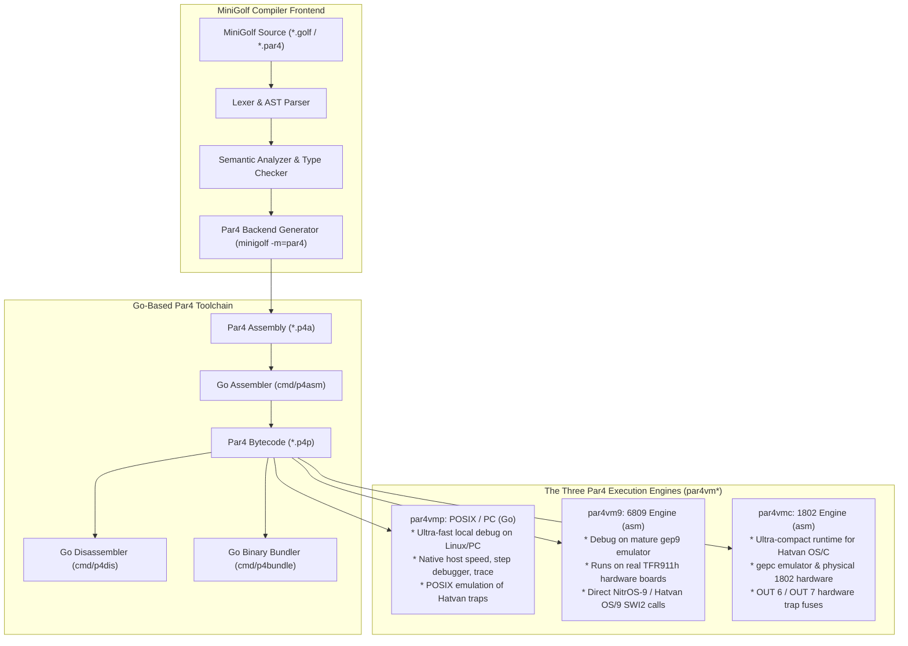

# Par4 Language, Virtual Machine & Toolchain Specification

**Architecture Specification for MiniGolf on Hatvan OS (COSMAC 1802, 6809 & POSIX Targets)**

* **Document:** `doc/par4-language-documentation.md`
* **Version:** 1.1
* **Date:** October 2026
* **Source Languages:** MiniGolf (`*.golf`) and Par4 (`*.par4`)
* **Assembly Target:** Par4 Assembly (`*.p4a`)
* **Bytecode Target:** Par4 P-Codes (`*.p4p`)
* **Binary Magic:** `b"P4P\x01"` (`0x50 0x34 0x50 0x01`)
* **Reference Toolchain:** Go (`cmd/p4asm`, `cmd/p4dis`, `cmd/p4bundle`)
* **The Three Execution Engines (`par4vm*`):**
  * **`par4vmp`** (POSIX / PC): Written in **Go** for Linux, macOS, and Windows. Rapid local debugging and CI testing.
  * **`par4vm9`** (6809 / 6309): Written in **6809 Assembly** for `gep9` emulator and **TFR911h** hardware boards.
  * **`par4vmc`** (COSMAC 1802): Written in **1802 Assembly** for `gepc` emulator and physical CDP1802 hardware.

---

## 1. Vision, Goals & The Three-Tier VM Architecture

### 1.1 The Role of Par4 in the Ecosystem
**Par4** is a direct superset and evolution of **Par3**. 
* **Par3** is frozen and preserved for its specific, critical mission: self-hosting its own compiler within a strict 64 KB 6809/6309 address space under NitrOS-9.
* **Par4** extends the proven concepts of Par3 (dense 1-byte opcodes, untagged 16-bit operand stack, 3-word slices, variable-table storage) with enhancements required to make it the **primary backend for MiniGolf** targeting **Hatvan OS**, specifically for memory-constrained 8-bit CPUs like the **RCA COSMAC CDP1802** and **Motorola 6809**.
* All tools (assembler, disassembler, bundler) and the POSIX reference VM (`par4vmp`) are implemented in **Go** to ensure clean cross-platform portability, high compilation speed, and direct integration into the MiniGolf repository without external Python dependencies.



---

### 1.2 The Three-Tier Debugging Workflow

Developing and debugging bytecode programs directly on primitive hardware like the 1802 can be challenging due to minimal tooling and slow emulation. Par4 defines a **tri-tier debugging progression** that dramatically accelerates development:

```
+-------------------------------------------------------------------------------+
| Tier 1: Local Development & Unit Testing                                      |
| Engine: par4vmp (Go on Linux / PC)                                            |
| Turnaround: Milliseconds. Zero emulator overhead. Full symbolic traces,       |
| stack dumps, source-level error line reporting, and POSIX file I/O mocks.     |
+---------------------------------------+---------------------------------------+
                                        |
                                        v
+-------------------------------------------------------------------------------+
| Tier 2: Real 8-Bit Architecture & System Call Validation                      |
| Engine: par4vm9 (6809 Assembly on gep9 and TFR911h boards)                    |
| Turnaround: Seconds. Tests 16-bit word stack semantics, big-endian binary     |
| packing, and true OS-9 system calls on mature, rock-solid 6809 tooling.       |
+---------------------------------------+---------------------------------------+
                                        |
                                        v
+-------------------------------------------------------------------------------+
| Tier 3: Target Deployment on RCA COSMAC 1802                                  |
| Engine: par4vmc (1802 Assembly on gepc and physical CDP1802 hardware)         |
| Turnaround: Verified bytecode runs with split-page jump tables and OUT 6/7    |
| hardware fuses in Hatvan OS/C tasks. Zero logic bugs remain to debug!         |
+-------------------------------------------------------------------------------+
```

---

### 1.3 Why Bytecode on the RCA CDP1802?

The RCA 1802 has only an 8-bit ALU, no 16-bit operations, no indexed addressing with offsets (`M[R+disp]`), no hardware stack pointer, and no native `CALL`/`RET`. 

Targeting native 1802 machine code for a rich language like MiniGolf causes massive code bloat:
* A 16-bit variable load or stack push requires 4–6 instructions (8–12 bytes).
* A 16-bit addition requires 8 instructions (16 bytes).
* Function calls require SCRT linkages (6–10 bytes per call).
* Struct field accesses require loading offsets and computing 16-bit address additions byte-by-byte in accumulator $D$.

In native 1802 assembly, a 500-line MiniGolf program can easily expand to **25 KB – 40 KB**, filling or exceeding the 64 KB memory space of a Hatvan OS user task.

**Par4 Bytecode solves this completely**:
* 16-bit operations (`ADD`, `SUB`, `CMP_EQ`, `LOAD_LOCAL_0`, `STORE_LOCAL_0`, `RET`) are **1 byte each**.
* Complex primitives (slices, string comparisons, memory copying) are handled by compact runtime VM helpers.
* The 1802 VM interpreter (`par4vmc`) is written **once** (~2.5 KB – 3.5 KB).
* MiniGolf programs compile down to **1.5 KB – 4 KB** `.p4p` binaries ($6\times$ to $10\times$ smaller than native 1802 machine code), leaving $>50\text{ KB}$ of RAM for application heaps, frame buffers, and stacks.

---

### 1.4 Current Language Scope & Deliberate Restrictions

To keep the initial 1802 VM interpreter (`par4vmc`) small (<3 KB), simplify its split-page jump tables, and accelerate bringing up the core system, Par4 currently retains two deliberate simplifications inherited from Par3:

1. **Unsigned Arithmetic Only (No Signed `int` / `int16`)**:
   * **Compiler Restriction**: Declaring variables of type `int` or `int16`, or casting with `int(x)` or `int16(x)`, is rejected at compile time with an explicit panic (`use unsigned 'word' or 'byte'`).
   * **Bytecode Semantics**: The primary arithmetic and comparison opcodes (`DIV`, `MOD`, `CMP_LT`, `CMP_LE`, `CMP_GT`, `CMP_GE`) operate on raw unsigned 16-bit words (`uint16`). Memory addresses, loop indices, counts, and scalar values are all represented as unsigned `word` (0..65535) or `byte` (0..255).
   * **Future Expansion**: Par4 can be extended in the future to introduce explicit signed comparison (`CMP_SLT`, `CMP_SGT`, etc.) and signed division (`DIV_S`, `MOD_S`) opcodes or type-directed opcode emission to support full signed `int` semantics across all MiniGolf programs.

2. **Concrete Types Only (No User-Defined Generics)**:
   * **Compiler Restriction**: User-defined generic structs (`type Tree[K, V] struct`) and generic functions (`func Map[T](...)`) are not supported. Generic templates (`len(s.TypeParameters) > 0`) are skipped during AST code generation.
   * **Compiler Pseudo-Generics**: The bracketed syntax `slice[T]` and `Smap[T]` is reserved exclusively for compiler-intrinsic collections, which are lowered to uniform 6-byte runtime headers (`[ptr, cap, len]`).
   * **Future Expansion**: When full MiniGolf compatibility is required, the MiniGolf frontend semantic analyzer's monomorphization pass can be run prior to Par4 AST code generation to expand user-defined generic templates into concrete AST nodes.

---

## 2. Par4 Binary File Format (`*.p4p`)

The `.p4p` binary executable format is structured as follows:

```text
+-----------------------------------------------------------------------+
| 1. Header (16 bytes)                                                  |
+-----------------------------------------------------------------------+
| 2. Global Variable Table (2 bytes per global: 16-bit size in bytes)   |
+-----------------------------------------------------------------------+
| 3. Raw String Pool (Length-prefixed, null-terminated bytes)           |
+-----------------------------------------------------------------------+
| 4. Function Table (10 bytes per function)                             |
+-----------------------------------------------------------------------+
| 5. Local Variable Tables (Packed sizes in bytes)                      |
+-----------------------------------------------------------------------+
| 6. Bytecode Section (Stream of 1-byte opcodes and arguments)          |
+-----------------------------------------------------------------------+
```

### 2.1 Header Specification (16 Bytes)

Multi-byte integers are stored in **Big-Endian** order.

| Offset | Size | Field Name | Description |
| :---: | :---: | :--- | :--- |
| `0x00` | 4 | `Magic` | 4-byte magic identifier: `0x50 0x34 0x50 0x01` (`"P4P\x01"`). |
| `0x04` | 1 | `FormatVer` | Bytecode version: `1`. |
| `0x05` | 1 | `Flags` | Execution flags (Bit 0 = 1802 optimized, Bit 1 = Shared Curtain Access). |
| `0x06` | 2 | `StringPoolSize` | Total byte size of the raw String Pool section. |
| `0x08` | 2 | `GlobalsCount` | Number of global variables in the Global Var Table. |
| `0x0A` | 2 | `FuncCount` | Number of functions in the Function Table. |
| `0x0C` | 2 | `EntryFunc` | Function index of the entry point (`main`). |
| `0x0E` | 2 | `CodeSize` | Total byte size of the Bytecode Section. |

### 2.2 Global Variable Table (`GlobalsCount * 2` Bytes)

Each entry in the Global Variable Table is stored as a 16-bit big-endian integer representing the variable's byte size (supporting static arrays, buffers, and tables up to 64 KB). The total length of this section is `GlobalsCount * 2` bytes.

### 2.3 Function Table Entry (10 Bytes)
* `ArgCount` (1 byte): Number of parameter variables.
* `LocalCount` (1 byte): Number of local variables.
* `FrameSize` (2 bytes): Total local frame size in bytes ($\sum \text{local sizes}$).
* `CodeOffset` (2 bytes): Bytecode entry point offset relative to Bytecode Section.
* `CodeSize` (2 bytes): Bytecode size in bytes.
* `VarTableOffset` (2 bytes): Offset into Local Variable Tables section.

---

## 3. The Hatvan Kernel Binary Interface (`HATVAN_TRAP`)

The signature architectural enhancement in Par4 is replacing hardcoded high-level file/OS opcodes with a unified, direct **Hatvan Kernel Binary Interface**.

### 3.1 The 2-Byte Opcode: `HATVAN_TRAP <imm8>`
* **Opcode**: `0xC0` (`HATVAN_TRAP` or `OS_CALL`).
* **Argument**: 1 byte (`<call_num>`), representing the standard Hatvan OS / OS-9 system call number.
* **Stack Protocol**:
  Arguments are pushed in logical order and popped into the kernel register frame:
  $$\text{Stack on entry: } [A, B, X, Y, U]$$
  $$\text{Stack on return: } [res\_A, res\_B, res\_Y, err\_bool]$$

```
Operand Stack Top:  [ U ]  (16-bit: Parameter block pointer)
                    [ Y ]  (16-bit: Byte count / length)
                    [ X ]  (16-bit: Buffer address or pathname pointer)
                    [ B ]  (16-bit: Secondary byte / mode / options)
                    [ A ]  (16-bit: Path ID / primary byte)
```

### 3.2 Common Hatvan OS System Call Mapping

| Hex | Name | Par4 Usage | Registers (Entry) | Registers (Exit) |
| :---: | :--- | :--- | :--- | :--- |
| **`$84`** | `I$Open` | Open existing path | $A=\text{mode}, X=\text{path\_ptr}$ | $A=\text{path\_id}, DF=\text{err}$ |
| **`$83`** | `I$Create`| Create/truncate path | $A=\text{mode}, X=\text{path\_ptr}$ | $A=\text{path\_id}, DF=\text{err}$ |
| **`$89`** | `I$Read` | Binary read | $A=\text{path}, X=\text{buf}, Y=\text{count}$ | $Y=\text{actual}, DF=\text{err}$ |
| **`$8A`** | `I$Write` | Binary write | $A=\text{path}, X=\text{buf}, Y=\text{count}$ | $Y=\text{actual}, DF=\text{err}$ |
| **`$8B`** | `I$ReadLn`| Read text line | $A=\text{path}, X=\text{buf}, Y=\text{max}$ | $Y=\text{actual}, DF=\text{err}$ |
| **`$8C`** | `I$WritLn`| Write line + CR | $A=\text{path}, X=\text{buf}, Y=\text{count}$ | $Y=\text{actual}, DF=\text{err}$ |
| **`$8F`** | `I$Close` | Close path | $A=\text{path}$ | $DF=\text{err}$ |
| **`$06`** | `F$Exit` | Terminate task | $A=\text{exit\_code}$ | *(Does not return)* |
| **`$03`** | `F$Fork` | Spawn child task | $A=\text{type}, Y=\text{mem}, U=\text{params}$ | $A=\text{child\_pid}, DF=\text{err}$ |
| **`$04`** | `F$Wait` | Wait for child | — | $A=\text{child\_pid}, B=\text{status}$ |
| **`$07`** | `F$Mem` | Adjust task memory | $Y=\text{new\_size}$ | $Y=\text{actual\_size}, X=\text{new\_end}$ |
| **`$0A`** | `F$Sleep` | Sleep ticks (60Hz) | $X=\text{ticks}$ | — |

---

## 4. Complete Par4 Instruction Set Architecture (ISA)

### 4.1 Group 1: Stack & Literals (`0x00 .. 0x1F`)

| Opcode | Mnemonic | Arg Bytes | Operand | Stack Effect | Description |
| :---: | :--- | :---: | :---: | :--- | :--- |
| `0x00` | `NOP` | 0 | None | `[] -> []` | No operation. |
| `0x01` | `PUSH_NIL` | 0 | None | `[] -> [$0000]` | Push scalar zero/nil word. |
| `0x02` | `PUSH_NIL_SLICE`| 0 | None | `[] -> [0, 0, 0]` | Push nil slice `{ ptr: 0, cap: 0, len: 0 }`. |
| `0x03` | `PUSH_TRUE` | 0 | None | `[] -> [$0001]` | Push boolean `true`. |
| `0x04` | `PUSH_FALSE` | 0 | None | `[] -> [$0000]` | Push boolean `false`. |
| `0x05` | `PUSH_0` | 0 | None | `[] -> [$0000]` | Push integer 0. |
| `0x06` | `PUSH_1` | 0 | None | `[] -> [$0001]` | Push integer 1. |
| `0x07` | `PUSH_NEG1` | 0 | None | `[] -> [$FFFF]` | Push integer -1. |
| `0x08` | `PUSH_I8` | 1 | `<imm8_s>` | `[] -> [val]` | Push sign-extended 8-bit integer (-128..127). |
| `0x09` | `PUSH_U8` | 1 | `<imm8_u>` | `[] -> [val]` | Push zero-extended 8-bit unsigned integer (0..255). |
| `0x0A` | `PUSH_I16` | 2 | `<imm16>` | `[] -> [val]` | Push 16-bit big-endian integer. |
| `0x0B` | `PUSH_STR` | 2 | `<str16>` | `[] -> [ptr, cap, len]` | Push 3-word string slice referencing String Pool. |
| `0x0C` | `POP` | 0 | None | `[a] -> []` | Discard top 16-bit word. |
| `0x0D` | `POP_SLICE` | 0 | None | `[ptr, cap, len] -> []` | Discard top 3-word slice. |
| `0x0E` | `DUP` | 0 | None | `[a] -> [a, a]` | Duplicate top 16-bit word. |
| `0x0F` | `SWAP` | 0 | None | `[a, b] -> [b, a]` | Swap top two 16-bit words. |
| `0x10` | `DUP2` | 0 | None | `[a, b] -> [a, b, a, b]` | Duplicate top two 16-bit words. |
| `0x11` | `ROT` | 0 | None | `[a, b, c] -> [b, c, a]` | Rotate top three words. |

---

### 4.2 Group 2: Variables, Pointers & Memory (`0x20 .. 0x3F`)

| Opcode | Mnemonic | Arg Bytes | Operand | Stack Effect | Description |
| :---: | :--- | :---: | :---: | :--- | :--- |
| `0x20` | `LOAD_LOCAL_0` .. `LOAD_LOCAL_3` | 0 | None | `[] -> [val...]` | Fast load from local slots 0..3 (size from VarTable). |
| `0x24` | `STORE_LOCAL_0` .. `STORE_LOCAL_3`| 0 | None | `[val...] -> []` | Fast store to local slots 0..3 (size from VarTable). |
| `0x28` | `LOAD_LOCAL` | 1 | `<local8>` | `[] -> [val...]` | Load variable from local slot `imm8`. |
| `0x29` | `STORE_LOCAL` | 1 | `<local8>` | `[val...] -> []` | Store variable into local slot `imm8`. |
| `0x2A` | `LOAD_GLOBAL` | 2 | `<global16>` | `[] -> [val...]` | Load variable from global slot `imm16`. |
| `0x2B` | `STORE_GLOBAL` | 2 | `<global16>` | `[val...] -> []` | Store variable into global slot `imm16`. |
| `0x30` | `ADDR_OF_GLOBAL` | 2 | `<global16>`| `[] -> [addr]` | Push absolute address of global slot `imm16`. |
| `0x31` | `PEEK2` | 0 | None | `[addr] -> [word]` | Load 16-bit word from memory at `addr`. |
| `0x32` | `POKE2` | 0 | None | `[word, addr] -> []` | Store 16-bit word to memory at `addr`. |
| `0x33` | `PEEK1` | 0 | None | `[addr] -> [byte]` | Load 8-bit byte from memory at `addr` (zero-extended). |
| `0x34` | `POKE1` | 0 | None | `[byte, addr] -> []` | Store lower 8 bits of `byte` to memory at `addr`. |
| `0x35` | `ADDR_OF_LOCAL` | 1 | `<local8>` | `[] -> [addr]` | Push absolute memory address of local variable slot `imm8`. |
| `0x36` | `SHL1_ADD` | 0 | None | `[base, idx] -> [base + idx*2]` | Fast 16-bit word array indexing calculation. |
| `0x37` | `MEM_COPY` | 0 | None | `[src, dst, count] -> []` | Copy `count` bytes from `src` to `dst` (struct / array copy). |
| `0x38` | `MEM_SET` | 0 | None | `[dst, val, count] -> []` | Set `count` bytes at `dst` to `val` (zeroing structures). |

---

### 4.3 Group 3: Arithmetic, Logic & Comparisons (`0x40 .. 0x5F`)

| Opcode | Mnemonic | Arg Bytes | Operand | Stack Effect | Description |
| :---: | :--- | :---: | :---: | :--- | :--- |
| `0x40` | `ADD` | 0 | None | `[a, b] -> [a + b]` | 16-bit integer addition. |
| `0x41` | `SUB` | 0 | None | `[a, b] -> [a - b]` | 16-bit integer subtraction. |
| `0x42` | `MUL` | 0 | None | `[a, b] -> [a * b]` | 16-bit unsigned integer multiplication. |
| `0x43` | `DIV` | 0 | None | `[a, b] -> [a / b]` | 16-bit unsigned integer division. |
| `0x44` | `MOD` | 0 | None | `[a, b] -> [a % b]` | 16-bit unsigned integer modulo. |
| `0x45` | `NEG` | 0 | None | `[a] -> [-a]` | 16-bit integer negation. |
| `0x46` | `BIT_AND` | 0 | None | `[a, b] -> [a & b]` | 16-bit bitwise AND. |
| `0x47` | `BIT_OR` | 0 | None | `[a, b] -> [a \| b]` | 16-bit bitwise OR. |
| `0x48` | `BIT_XOR` | 0 | None | `[a, b] -> [a ^ b]` | 16-bit bitwise XOR. |
| `0x49` | `BIT_NOT` | 0 | None | `[a] -> [~a]` | 16-bit bitwise NOT. |
| `0x4A` | `SHL` | 0 | None | `[a, b] -> [a << b]` | 16-bit logical shift left. |
| `0x4B` | `SHR` | 0 | None | `[a, b] -> [a >> b]` | 16-bit arithmetic shift right. |
| `0x4C` | `CMP_EQ` | 0 | None | `[a, b] -> [bool]` | Equal (`==`). Pushes `$0001` or `$0000`. |
| `0x4D` | `CMP_NE` | 0 | None | `[a, b] -> [bool]` | Not equal (`!=`). |
| `0x4E` | `CMP_LT` | 0 | None | `[a, b] -> [bool]` | Unsigned less than (`<`). |
| `0x4F` | `CMP_LE` | 0 | None | `[a, b] -> [bool]` | Unsigned less than or equal (`<=`). |
| `0x50` | `CMP_GT` | 0 | None | `[a, b] -> [bool]` | Unsigned greater than (`>`). |
| `0x51` | `CMP_GE` | 0 | None | `[a, b] -> [bool]` | Unsigned greater than or equal (`>=`). |
| `0x52` | `NOT` | 0 | None | `[a] -> [bool]` | Logical NOT: `$0001` if `a == 0`, else `$0000`. |

---

### 4.4 Group 4: Control Flow & Calls (`0x60 .. 0x6F`)

| Opcode | Mnemonic | Arg Bytes | Operand | Stack Effect | Description |
| :---: | :--- | :---: | :---: | :--- | :--- |
| `0x60` | `JUMP` | 2 | `<rel16>` | `[] -> []` | Relative unconditional branch. |
| `0x61` | `JUMP_IF_TRUE` | 2 | `<rel16>` | `[cond] -> []` | Branch if `cond != $0000`. |
| `0x62` | `JUMP_IF_FALSE`| 2 | `<rel16>` | `[cond] -> []` | Branch if `cond == $0000`. |
| `0x63` | `CALL` | 2 | `<func16>` | `[args...] -> [res...]` | Call function `imm16`. |
| `0x64` | `RET` | 0 | None | `[res] -> [...]` | Return 16-bit word to caller. |
| `0x65` | `RET_SLICE` | 0 | None | `[ptr, cap, len] -> [...]`| Return 3-word slice to caller. |
| `0x66` | `RET_VOID` | 0 | None | `[] -> [...]` | Return void (`$0000`) to caller. |
| `0x67` | `HALT` | 0 | None | `[] -> []` | Halt VM execution cleanly. |
| `0x68` | `PANIC` | 0 | None | `[str_slice] -> []` | Print panic error message and exit task. |

---

### 4.5 Group 5: Slices & Strings (`0x70 .. 0x77`)

| Opcode | Mnemonic | Arg Bytes | Operand | Stack Effect | Description |
| :---: | :--- | :---: | :---: | :--- | :--- |
| `0x70` | `SLICE_NEW` | 0 | None | `[ptr, cap, len] -> [slice]`| Construct 3-word slice from components. |
| `0x71` | `SLICE_LEN` | 0 | None | `[slice] -> [len]` | Extract length from slice. |
| `0x72` | `SLICE_CAP` | 0 | None | `[slice] -> [cap]` | Extract capacity from slice. |
| `0x73` | `SLICE_SUB` | 0 | None | `[slice, start, end] -> [view]`| Zero-allocation sub-slice view. |
| `0x77` | `STR_CMP` | 0 | None | `[slice_a, slice_b] -> [res]`| Lexicographical comparison (-1, 0, +1). |

---

### 4.8 Group 8: Hatvan OS & Hardware Primitives (`0xC0 .. 0xCF`)

| Opcode | Mnemonic | Arg Bytes | Operand | Stack Effect | Description |
| :---: | :--- | :---: | :---: | :--- | :--- |
| **`0xC0`** | **`HATVAN_TRAP`** | **1** | **`<imm8>`** | **`[A, B, X, Y, U] -> [res_A, res_B, res_Y, err]`** | **Direct Hatvan OS System Call (`OUT 6` trap).** |
| `0xC1` | `HATVAN_UNTRAP` | 0 | None | `[res_A, res_B, res_Y, err] -> []` | Synthetic return-from-trap trampoline at `$0030` in `par4vmc.asm` (DMA-copies syscall return words to caller task's stack and restores user task context). |
| `0xC8` | `SYS_EXIT` | 0 | None | `[code] -> []` | Exit task with status code (`F$Exit`). |
| `0xC9` | `IO_PRINT` | 0 | None | `[str_slice] -> []` | Print string followed by newline (`I$WritLn`). |

---

## 5. Execution Engine Architectures: The `par4vm*` Family

### 5.1 `par4vmp`: POSIX / PC Execution Engine (Go)
* **Role**: Rapid developer iteration, host unit testing, CI regression testing.
* **Architecture**: Implemented in pure Go within `cmd/p4vm`.
* **Execution Model**:
  * An untagged 16-bit slice `[]uint16` serves as the operand stack.
  * Direct table dispatch via Go function array: `var handlers [256]func(vm *VM)`.
  * **Hatvan OS Traps on Host**: `HATVAN_TRAP` maps OS-9 calls directly to standard Go / POSIX library equivalents:
    * `I$Open` $\to$ `os.OpenFile()`
    * `I$Read` / `I$ReadLn` $\to$ `file.Read()`
    * `I$Write` / `I$WritLn` $\to$ `file.Write()`
    * `I$Close` $\to$ `file.Close()`
    * `F$Exit` $\to$ `os.Exit()`
  * **Debugging Features**:
    * `-trace`: Prints every instruction opcode and operands as they execute.
    * `-stack`: Dumps the entire operand stack before every instruction.
    * `-step`: Interactive single-stepping debugger with breakpoint support.

---

### 5.2 `par4vm9`: Motorola 6809 / Hitachi 6309 Execution Engine (Assembly)
* **Role**: Real 8-bit architecture debugging on mature `gep9` emulator and **TFR911h** coprocessor boards.
* **Architecture**: Written in 6809 assembly language.
* **Register Allocation**:
  * `X`: Bytecode Program Counter (`R_P4PC`).
  * `U`: Operand Stack Pointer (`R_P4SP`). Pushes via `pshu d`, pops via `pulu d`.
  * `Y`: Local Frame Pointer (`R_P4FP`).
  * `S`: Native Call Stack (`R_SYS_SP`).
  * `D`: 16-bit work accumulator (`A` and `B`).
* **Dispatch Loop (Compact)**:
  ```assembly
  DispatchNext:
      ldb   ,x+                 ; Fetch opcode, X++
      clra
      aslb                      ; Opcode * 2
      rola
      ldu   #OpcodeTable        ; Base of 16-bit vector table
      jmp   [d,u]               ; Direct indirect jump to handler
  ```
* **Syscall Trap (`HATVAN_TRAP`)**:
  Pulls `U, Y, X, B, A` from operand stack `U` into native 6809 registers, and executes the native OS-9 `swi2` trap:
  ```assembly
  Op_HATVAN_TRAP:
      ldb   ,x+                 ; B = call_num
      stb   _TrapNum
      pulu  u                   ; Pop U
      pulu  y                   ; Pop Y
      pulu  x                   ; Pop X
      pulu  d                   ; Pop B (in B)
      tfr   b,a                 ; Move B to A
      pulu  b                   ; Pop B
      swi2                      ; Execute OS-9 Trap!
  _TrapNum:
      .db   0
      ; Push return values onto U stack:
      ...
      bra   DispatchNext
  ```

---

### 5.3 `par4vmc`: RCA COSMAC 1802 Execution Engine (Assembly)
* **Role**: Target runtime for Hatvan OS/C (`gepc`) and physical CDP1802 hardware.
* **Architecture**: Written in 1802 assembly language.

#### Scratchpad Register Allocation
| Register | Native Role | `par4vmc` Function |
| :---: | :--- | :--- |
| **$R(0)$** | Reset / DMA | Hardware DMA / Boot scratch |
| **$R(1)$** | Interrupt PC | Hardware Interrupt PC (Hatvan kernel) |
| **$R(2)$** | Stack Pointer (`SP`) | Native Call Stack (used for subroutines and interrupts) |
| **$R(3)$** | **`R_DISPATCH`** | **Interpreter Dispatch PC**: loops fetching and dispatching bytecodes ($P=3$). |
| **$R(4)$** | **`R_EXEC`** | **Opcode Handler PC**: executes the current bytecode handler ($P=4$). |
| **$R(5)$** | **`R_P4PC`** | **Par4 Bytecode PC**: points to next bytecode instruction (`LDA R5`). |
| **$R(6)$** | **`R_P4SP`** | **Par4 Operand Stack Pointer**: 16-bit big-endian stack, grows downward. |
| **$R(7)$** | **`R_P4FP`** | **Par4 Frame Pointer**: local variable base pointer / Syscall Reg $X$. |
| **$R(8)$** | **`R_STRPOOL`** | **String Pool Base Address** / Syscall Reg $Y$. |
| **$R(9)$** | **`R_GLOBALS`** | **Globals Storage Base Address** / Syscall Reg $U$. |
| **$R(\text{A})$** | **`R_T0`** | **VM Temp 0**: primary 16-bit accumulator / Syscall Reg $B$. |
| **$R(\text{B})$** | **`R_T1`** | **VM Temp 1**: secondary 16-bit scratchpad register. |
| **$R(\text{C})$** | **`R_TBL_LO`** | **Split Table Low Pointer**: points to page-aligned `OpcodeTableLo`. |
| **$R(\text{D})$** | **`R_TBL_HI`** | **Split Table High Pointer**: points to page-aligned `OpcodeTableHi`. |
| **$R(\text{E})$** | **`R_TRAP`** | **Syscall Trap Vector**: preloaded to `$0004` (enables `SEP RE` trap). |
| **$R(\text{F})$** | **`R_SCRATCH`** | Memory copy pointer / dict scan / untrap linkage. |
| **`D`** | Accumulator | 8-bit working accumulator / Syscall Reg $A$. |
| **`DF`** | Carry Flag | Error status bit ($0 = \text{success}, 1 = \text{error}$). |

#### Split-Page Jump Table Dispatch Engine
Two 256-byte vector tables aligned to page boundaries:
* `OpcodeTableLo` at `$xx00`
* `OpcodeTableHi` at `$yy00`

```assembly
; ==============================================================================
; Core Dispatch Loop in R(3): P = 3
; ==============================================================================
DispatchNext:
    LDA  R_P4PC         ; 2 cyc: D = fetch opcode, R_P4PC++
    PLO  R_TBL_LO       ; 2 cyc: R_TBL_LO.0 = opcode
    PLO  R_TBL_HI       ; 2 cyc: R_TBL_HI.0 = opcode
    LDN  R_TBL_LO       ; 2 cyc: D = HandlerLo[opcode]
    PLO  R_EXEC         ; 2 cyc: R_EXEC.0 = HandlerLo
    LDN  R_TBL_HI       ; 2 cyc: D = HandlerHi[opcode]
    PHI  R_EXEC         ; 2 cyc: R_EXEC.1 = HandlerHi
    SEP  R_EXEC         ; 2 cyc: Switch P to R(4) -> Jump to Handler!

; Inside each opcode handler (P = 4):
; ... handler code executes ...
; Handler returns to dispatch loop:
    SEP  R3             ; 2 cyc: Switch P back to R(3) (DispatchNext)!
```
* **Total Dispatch Overhead:** Exactly **18 machine cycles** (36 µs at 4.0 MHz).

#### Syscall Trap Handler in `par4vmc`
```assembly
Op_HATVAN_TRAP:
    LDA  R_P4PC         ; D = fetch inline call_num
    PLO  R_SCRATCH      ; Save call_num
    ; Pop U, Y, X, B, A into R9, R8, R7, RA.0, D
    ... pop stack words ...
    ; Execute Hatvan Syscall via Port 6 Trap Fuse:
    SEP  RE             ; Switch P to R(E) (Trap Pointer at $0004)
_TrapByte:
    .db  0              ; Trampoline reads this byte and strobes Port 6!
    ; Returns here via Port 7 Untrap Fuse:
    ... push results and DF carry onto R_P4SP ...
    SEP  R3             ; Return to dispatch loop!
```

---

## 6. MiniGolf Par4 Backend (`minigolf -m=par4`)

The Par4 backend translates MiniGolf AST structures directly into clean `.p4a` assembly text.

### 6.1 Strict PEEK / POKE Stack Balance
In MiniGolf:
* `peekb(addr)` $\to$ `LOAD_EXPR addr; PEEK1` (pushes byte).
* `peekw(addr)` $\to$ `LOAD_EXPR addr; PEEK2` (pushes word).
* `pokeb(addr, val)` as statement:
  ```assembly
  LOAD_EXPR val
  LOAD_EXPR addr
  POKE1                 ; pops addr, pops val; stores byte; pushes nothing!
  ```
* No stray `POP` instructions are emitted for `POKE` statements.

### 6.2 Struct Copies & Multi-Word Assignments
MiniGolf allows full struct value assignments:
```go
type Point struct { x, y word }
var a, b Point
a = b
```
Par4 backend emits:
```assembly
    ADDR_OF_GLOBAL b
    ADDR_OF_GLOBAL a
    PUSH_I8 4
    MEM_COPY            ; 4 bytes copied from b to a in single native loop
```

### 6.3 Switch Statement Lowering
Par4 supports both tagged and boolean switch statements:
* **Integer / Boolean Cases**: Lowered to `LOAD_TAG; PUSH_VAL; CMP_EQ; JUMP_IF_TRUE lbl_case`.
* **String Switches**: Lowered to `LOAD_TAG; PUSH_STR "text"; STR_CMP; NOT; JUMP_IF_TRUE lbl_case`.

### 6.4 Supported & Unsupported MiniGolf Features

* **Supported Types**:
  * `byte` / `uint8`: 8-bit unsigned scalar (zero-extended to 16 bits on the operand stack).
  * `word` / `uint` / `uint16` / pointers: 16-bit unsigned scalar.
  * `bool`: 16-bit scalar (`0` = false, `1` = true).
  * `string`: 6-byte slice header pointing to immutable null-terminated byte array.
  * `slice[T]`: 6-byte slice header (`ptr: word`, `cap: word`, `len: word`).
  * `Smap[T]`: String hash map / dict (built upon 6-byte slice backing store).
  * Concrete user `struct`: Flattened memory block (global or heap-allocated via `alloc`).
* **Temporarily Restricted MiniGolf Features**:
  * `int`, `int16`: Forbidden at compile-time (`use unsigned 'word' or 'byte'`).
  * User-defined generic templates: e.g. `type Tree[K, V] struct` or `func Map[T](...)`.
  * Floating-point types: `float32`, `float64`.
  * Stack-allocated fixed buffers: Small local array buffers (`[N]byte` up to 255 bytes) are supported. Larger buffers must be declared `.global` or allocated via `alloc()`.
  * `defer` statements and named return values.

---

## 7. The Go-Based Toolchain

To eliminate Python dependencies and keep toolchain execution fast and uniform, all Par4 tools are built in Go:

```
minigolf/
├── par4/
│   ├── opcodes.go      # Opcode definitions, metadata table, and mnemonics
│   ├── par4asm.go      # Bytecode assembler (text *.p4a -> binary *.p4p)
│   ├── par4dis.go      # Bytecode disassembler (binary *.p4p -> text *.p4a)
│   ├── par4vmp.go      # Go reference virtual machine with Hatvan OS trap hooks
│   ├── codegen.go      # MiniGolf AST -> Par4 assembly code generator
│   └── par4_test.go    # Unit tests and end-to-end execution suites
├── par4-lib/           # Par4 standard library modules (prelude, btree, rbtree, etc.)
└── cmd/
    ├── par4asm/        # Standalone Go assembler CLI (*.p4a -> *.p4p)
    ├── par4dis/        # Standalone Go disassembler CLI (*.p4p -> disassembly)
    ├── par4vmp/        # Standalone Go runner CLI (par4vmp reference engine)
    └── par4bundle/     # Standalone Go Hatvan binary packager CLI (future)
```

### 7.1 Assembler: `par4asm`
* Input: `.p4a` text file.
* Output: `.p4p` binary bytecode executable.
* Features: Two-pass label resolution, big-endian binary packing, string pool deduplication, escape sequence unquoting, comment stripping, and syntax validation.

### 7.2 Disassembler: `par4dis`
* Input: `.p4p` binary file.
* Output: Human-readable annotated disassembly with opcode mnemonic names, argument decoding, and function table headers.

### 7.3 Reference Runner: `par4vmp`
* Input: `.p4p` binary file.
* Executes bytecode instructions on host CPU with an internal 16-bit stack and simulated Hatvan OS system call hooks (`I$Open`, `I$Create`, `I$Close`, `I$ReadLn`, `I$WritLn`).

### 7.4 Packager / Bundler: `par4bundle`
* Combines `par4vmc.decb` (assembled 1802 interpreter) or `par4vm9` (assembled 6809 module) with target `.p4p` file.
* Emits a standalone executable that boots directly under Hatvan OS/C or Hatvan OS/9:
  ```bash
  gepc program.decb
  ```

---

## 8. Implementation Roadmap

### Phase 1: Go Toolchain & POSIX Engine (`par4vmp`)
* [x] Specification documented in [`doc/par4-language-documentation.md`](file:///home/strick/github.com/strickyak/minigolf/doc/par4-language-documentation.md).
* [x] Implement Par4 assembler in Go: `cmd/par4asm` and `par4/par4asm.go`.
* [x] Implement Par4 disassembler in Go: `cmd/par4dis` and `par4/par4dis.go`.
* [x] Implement POSIX reference engine in Go: `cmd/par4vmp` and `par4/par4vmp.go`.
* [x] Automated unit and syscall tests in `par4/par4_test.go`.

### Phase 2: MiniGolf Par4 Backend (`-m=par4`)
* [x] Create package `par4/` and library `par4-lib/` in MiniGolf codebase.
* [x] Implement `par4/codegen.go`, establishing strict stack balance for PEEK/POKE and struct block-copies.
* [x] Add `HATVAN_TRAP` emission for OS/file operations.
* [x] Wire `-m=par4` flag into `main.go`.
* [x] Validated with 7 benchmark programs (`basic_count10`, `test_8queens`, `test_btree`, `test_fib`, `test_for3`, `test_regexp`, `test_sort_strings`).

### Phase 3: 6809 Native Engine (`par4vm9`)
* [ ] Write 6809 assembly engine (`par4vm9.asm`).
* [ ] Validate test suite on `gep9` and TFR911h board.

### Phase 4: 1802 Native Engine (`par4vmc`)
* [ ] Write 1802 assembly core for `par4vmc`:
  - Split-page jump table dispatcher.
  - Groups 1–4 core stack, math, and flow control.
  - Group 8 `HATVAN_TRAP` handler (`SEP RE; .db <call_num>`).
* [ ] Assemble with 1802 cross-assembler into `par4vmc.decb`.
* [ ] Run MiniGolf test programs on `gepc` using `par4vmc.decb`.
